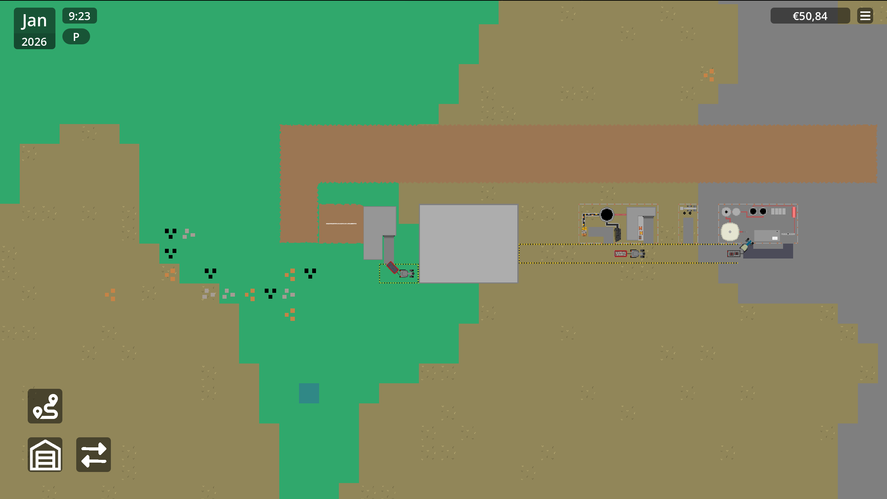

# Supply Chains

Supply Chains is a game inspired by transport fever and mindustry centered around building road networks and logistics chains around construction and mining operations, with farming and forestry planned for a future update.

## The goal
The goal of the game is to make a large supply chain between factories and mines and then sell the products you produce with the factories to expand your supply chain.

## Challenges
There where a lot of challenges during development of Supply Chains two of the more notable ones are the pathfinding I found it really hard to get the trailers to look sort of realistic behind vehicles and then getting the vehicles to actually follow that path, and the backing into factories that was (almost) impossible to do with pathfinding so I had to find a other solution I landed on pre-backed paths but this was also hard to implement it still doesn't look fully how I want especial with a trailer but it works and looks acceptable.

## How to play?
You can download it at: and there are download instructions there

## Stuck?
All the practical information is in the `help.md

## Known Limitations & In-Progress Features
Since I am a solo dev a lot of features did not get polished or straight up don't work I have tried my best to make the game as fun as possible with these limitations but not everything is perfect.
Things that don't work (yet):
- the articulated dumptruck. just didn't have time to make the articulation work
- there is currently only one hard coded plane did not have time for the rest
- helicopters are not used yet
- electricity is not used
- vehicle load is not set so fuel usage is zero
- no way to know how far construction is
- the recipe menu doesn't work (its not doing much with the current factories anyway)
- couple rare visual glitches
- concrete truck doesn't work (concrete is also almost useless with the current economy)
- the path of the pumpjack doesn't work
- no collisions and no road claiming (there could be 100 tractors driving on top of each other on the same road)
